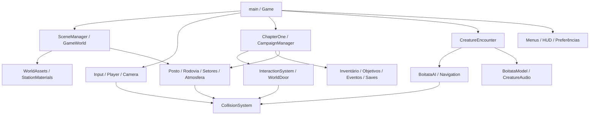

# Auditoria e preparação da reformulação Neo-PSX

Data: 30/10/2026. Etapa 1: documentação e checkpoint, sem mudanças no runtime.
Baseline: `b7059ad` (remoção das travas artificiais de investigação).
Checkpoint: tag anotada `checkpoint/pre-neo-psx-2026-10-30`.
Direção artística: [VISUAL_STYLE_GUIDE.md](VISUAL_STYLE_GUIDE.md).

## 1. Conclusão técnica

Manter Three.js, Vite e TypeScript. A estética proposta é viável com a tecnologia atual; não há justificativa demonstrada para trocar de engine. Os maiores problemas são organização dos assets, autoria visual, acoplamento por coordenadas e iluminação, não ausência de capacidade do renderizador. Nenhuma migração, substituição de mecânica ou reformulação visual foi executada nesta etapa.

A análise combina leitura do código, inventário de recursos/configurações, capturas históricas em `docs/station-remaster/`, testes automatizados e build. As capturas históricas são cenas de inspeção; algumas usam luz auxiliar e não comprovam a aparência durante blackout ou com a lanterna desligada. Gargalos inferidos do código estão separados de medições; não há perfil de GPU em celular físico.

## 2. Plataforma, renderização e recursos

| Área | Implementação encontrada |
|---|---|
| Runtime | Three.js 0.180.0, TypeScript estrito, módulos ES. Sem React, ECS ou engine de física externa |
| Ferramentas | Vite instalado 7.3.7 (manifesto `^7.1.12`), TS 5.9.3, Playwright Core 1.64.1. `package-lock.json` é a referência reprodutível |
| Renderizador | `WebGLRenderer`, WebGL2, `antialias:false`, `powerPreference:high-performance`. Render direto da cena; não há EffectComposer, ShaderMaterial ou GLSL autoral em `src` |
| Câmera | Perspectiva 68°, near 0,08; far ajustado para 28/48/72; câmera e lanterna vinculadas ao jogador |
| Qualidade | Resolução interna 0,25–1; presets 0,35/0,5/0,75; pixel ratio 1; ajuste adaptativo a cada 3 s, fator 0,6–1 |
| Pós-efeitos atuais | Dither/checker, scanlines e vinheta em CSS. Não são quantização de cor, UV afim ou vertex snapping em shader. CCTV também usa elementos CSS |
| Geometria | Primitivas Three.js, lathe/torus sanitários, meshes estáticos mesclados e InstancedMesh. Não há arquivos GLB/GLTF, rig humano ou pipeline de importação/modelagem |
| Materiais | Predominam Lambert e Basic, flat shading e emissivos. Sem pipeline PBR, normal maps ou lightmaps autorais |
| Texturas | Canvas procedural: nove famílias de 128² no posto, labels 512×128, documento 512×256, terreno 32²; ruído dinâmico de TV. NearestFilter; UVs métricos no posto |
| Luz | AmbientLight global, três pontos no posto, beacon na instalação, SpotLight da lanterna e um ponto da criatura. Neblina FogExp2. Sem sombras dinâmicas habilitadas |
| Público | Fonte VT323/WOFF2 com licença OFL e favicon SVG. Não há biblioteca de texturas/modelos/sons gravados em `public` |
| Deploy | `base:'./'`, chunk separado de Three.js, `dist/`; configurações Vercel/Netlify e GitHub Pages manual. Não foi feito deploy nesta auditoria |

### Áudio real versus infraestrutura

`AudioManager.ts` possui manifest vazio: chuva, insetos, vento e passos gravados **não estão disponíveis**. Ele suporta loops HTMLAudio e volume por distância, não espacialização HRTF. `StorySounds.ts` sintetiza telefone, eletricidade, estática e bomba; `CreatureAudio.ts` sintetiza grave, ruído, tensão musical e distorção, com PannerNode HRTF. `VolumeBus.ts` aplica master/música/efeitos. `DialogueManager.ts` aceita áudio opcional, mas a narrativa atual depende de legendas. Não confundir infraestrutura, efeitos sintetizados e assets ainda por produzir.

## 3. Mapa de arquivos e responsabilidades

| Arquivos/módulos analisados | Papel e fronteira a preservar |
|---|---|
| `src/main.ts`, `core/Game.ts` | Bootstrap, reinício, ciclo de vida, composição, bloqueio de input em modais/cenas, pausa e limpeza |
| `core/GameLoop.ts`, `core/SceneManager.ts` | RAF, delta limitado a 50ms, cena, câmera, luz ambiente, lanterna e CollisionSystem |
| `world/GameWorld.ts` | Composição do mundo; **BR-319 está aqui**, incluindo asfalto, acostamento, marcas, placa, lama, trilha e instalação. Energia, blackout e streaming |
| `world/GasStation.ts` | Planta, móveis, portas, iluminação e veículos. `vehicle()` também é chamado para o caminhão da estrada |
| `world/StationVisuals.ts` | Camada decorativa, UVs, acabamento, produtos, sanitários, mesclagem por material e descarte |
| `world/StationMaterials.ts`, `world/WorldAssets.ts` | Materiais/texturas exclusivos do posto versus recursos globais compartilhados, labels, primitiva box e registro de colisores |
| `world/WorldInteraction.ts` | Contrato de interação e WorldDoor: pivô, orientação, estado e caixas de colisão aberta/fechada |
| `world/ForestSectors.ts` | Floresta determinística em setores de 20m, 36 setores possíveis, vegetação instanciada e áreas livres reservadas |
| `world/Atmosphere.ts` | 700 segmentos de chuva, máscaras retangulares de cobertura, poças planas transparentes |
| `world/TestEnvironment.ts` | Cenário legado de diagnóstico; não é o cenário ativo. Preservar até decidir seu destino |
| `player/PlayerController.ts`, `player/CameraController.ts` | Raimundo é câmera/controlador, **não um avatar humano modelado**. Movimento, salto, gravidade, rotação e sensibilidades |
| `input/InputManager.ts`, `TouchInput.ts`, `VirtualJoystick.ts` | Teclado, pointer lock, arrasto e ponteiros independentes. Salto por Espaço; não há botão de salto touch |
| `systems/CollisionSystem.ts` | AABBs, movimento subdividido, raio 0,28, altura do olho 1,65 e limites ±58 |
| `systems/GraphicsSettings.ts`, `SettingsStore.ts`, `VisualPreferences.ts`, `PerformanceMonitor.ts` | Preferências persistentes, resolução/distância, efeitos CSS e `?fps` somente em DEV |
| `story/ChapterOne.ts`, `data/chapter1.ts` | Objetos/posições do capítulo inicial, suporte dos itens, documentos, rádio, gerador e narrativa |
| `story/InteractionSystem.ts`, `Inventory.ts`, `ObjectiveManager.ts` | Raycasting por proxies, inventário disponível/usado e fatos de progressão |
| `story/DialogueManager.ts`, `HorrorEventManager.ts`, `StoryEffects.ts` | Legendas, eventos executados uma vez, silhueta humana plana, ruído de TV e bomba |
| `story/SaveManager.ts` | Validação e persistência de capítulo 1, inventário, flags, puzzle e desbloqueios |
| `campaign/CampaignManager.ts`, `ChapterManager.ts`, `data/campaign.ts` | Capítulos 2–4, evidências, transmissor, três finais e reconciliação de ações fora de ordem |
| `campaign/CampaignWorld.ts` | Props de campanha, livros e apoios, arquivos na floresta, equipamento do posto e relógios. Geometria adicionada ao grupo do posto **também existe fora do posto** |
| `campaign/CutsceneManager.ts`, `CampaignSave.ts` | Movimento de câmera, transições e save/checkpoints de campanha |
| `creature/BoitataModel.ts` | Serpente de 28 segmentos instanciados, escamas, cabeça, olhos, curva Catmull-Rom e emissão |
| `creature/BoitataAI.ts`, `Navigation.ts` | Sete estados, visão/lanterna/ruído, A* limitado, deslocamento com obstáculos |
| `creature/CreatureEncounter.ts`, `CheckpointManager.ts` | Aparições, cobertura, captura, feedback, respawn e painel DEV `?aiDebug` |
| `audio/AudioManager.ts`, `StorySounds.ts`, `CreatureAudio.ts`, `VolumeBus.ts` | Fontes, síntese, mixagem, desbloqueio por gesto e descarte |
| `ui/MainMenu.ts`, `SettingsPanel.ts`, `MobileControls.ts`, `ChapterUI.ts`, `style.css` | Menu, configuração, inventário, puzzles, CCTV, HUD, legendas, safe areas e orientação |
| `vite-env.d.ts`, `index.html`, `package*.json`, `tsconfig.json`, `vite.config.ts` | Declarações, entrada HTML, dependências, tipagem e build |
| `.github/workflows/pages.yml`, `netlify.toml`, `vercel.json` | Publicação estática, sem backend de save |
| `tests/*.mjs`, `README.md`, `docs/RELEASE.md`, `docs/station-remaster/*` | Contratos de regressão, procedimentos e histórico visual. Documentação antiga pode descrever versões anteriores |

## 4. Dependências e contratos de regressão



Contratos críticos:

1. `WorldAssets.box()` normalmente cria mesh **e** AABB. Escalar, girar ou remover somente o mesh depois não atualiza seu colisor. `StationVisuals` deliberadamente preserva envelopes conservadores. Um novo modelo deve receber colisão explícita, não usar o detalhamento visual como física.
2. `InteractionSystem.register()` copia a posição para um proxy fixo de 0,65×0,65×0,35, alcance 2,8m. Não acompanha automaticamente um objeto movido. A orientação visual das portas laterais também não orienta esse proxy. Mover uma interação exige atualizar registro/proxy e testar dos dois lados.
3. Ordem das portas, nomes e índices são usados por `ChapterOne` (entrada índice 0, depósito índice 2). Não reordenar por conveniência artística.
4. Balcão, livros, gerador, relógio, relés, câmera, cobertura e checkpoints repetem coordenadas em vários arquivos. Atualizar cenário, proxies, suportes, gatilhos e testes como uma unidade. Apoiar papéis acima do acabamento final; evitar repetir o bug do documento enterrado no tampo.
5. Posto/coberturas determinam máscaras de chuva em `Atmosphere`; estradas, trilhas e arquivos determinam exclusões em `ForestSectors.clear`. Alterar footprints sem atualizar ambos causa chuva interna e árvores nas rotas.
6. O posto é zona protegida da criatura por `player.z < 17`, não por geometria ou sala. Waypoints e aparições também são coordenados manualmente. Não deslocar a região sem revisar navegação, percepção e checkpoints.
7. Escurecimento e restauração da energia são gameplay. Luzes decorativas/emissivos futuros devem responder aos mesmos estados, incluindo `reduceFlashes`.
8. Preservar: gaveta sem leitura obrigatória, solução dos puzzles sem posse obrigatória da dica, coleta antecipada/invertida e relés em ordem livre. `ChapterManager` ainda organiza estados internamente; a reconciliação de inventário/flags é essencial. Não reintroduzir barreiras apenas por objetivo do HUD.
9. `data/chapter1.ts` importa itens da campanha; a dependência inversa de campanha é de tipo. Manter essa distinção para não criar ciclo de inicialização em runtime.

### Saves e recuperação

Chaves distintas: `boitata-save-v1`, `boitata-campaign-v1`, `boitata-creature-v1`, `boitata-settings-v1`; `boitata-quality` legado e `.invalid` para quarentena do save inicial. As gravações entre sistemas não são transacionais. IDs/flags/schema versão 1 devem permanecer compatíveis; futuras alterações semânticas exigem migração testada, nunca apagar automaticamente o progresso.

O checkpoint Git recupera código/assets versionados, **não o LocalStorage do navegador**. Antes de testar migrações, exportar as chaves pelo DevTools no mesmo domínio e guardar os JSONs fora do repositório. Uma nova origem de preview possui outro armazenamento.

## 5. Diagnóstico visual e destino de cada elemento

| Elemento | Evidência / problema atual | Tratamento futuro |
|---|---|---|
| Posto | Grandes planos, mobiliário ainda derivado de cubos; acabamento e silhueta desiguais | Reconstruir módulos selecionados; preservar planta em U e acessos; substituir cascas visuais por partes |
| Veículos/bombas/gerador | Proporções e contornos simplificados; detalhes acrescentados sobre blocos | Reconstruir modelos de destaque dentro dos envelopes existentes; UV/atlas específicos |
| Livros, produtos e sanitários | Melhorias recentes já funcionais; produtos identificáveis e livros apoiados | Aprimorar materiais e variedade; não regredir para blocos genéricos, cartazes gigantes ou objetos flutuantes |
| BR-319 e terreno | Faixas retangulares, solo plano, terreno 32² repetido, transição rígida ao acostamento | Substituir texturas e composição de bordas; variação controlada e decals; relevo só após validar física |
| Floresta | Copas cônicas, raízes/cipós cilíndricos e baixa diversidade de silhueta | Reconstruir conjunto pequeno de espécies/variações com LOD, preservar instancing e áreas livres |
| Raimundo / aparições humanas | Câmera sem corpo; silhueta plana é efeito roteirizado | Preservar câmera e controle. Mãos/corpo seriam proposta separada; não assumir personagem completo existente |
| Boitatá | Movimento procedural já integrado; segmentos facetados e emissão uniforme | Aprimorar silhueta, ritmo de escamas e gradiente de emissão antes de substituir rig/movimento |
| Iluminação | Sem oclusão por sombras: luz pode atravessar paredes; reflexos são planos translúcidos | Testar iluminação assada/contato e luzes locais seletivas; não habilitar sombras globais por padrão |
| Paleta e texturas | Verde global comprime diferenças entre madeira, metal e cerâmica; ruído/tiling visíveis | Neutralizar por material, sujeira contextual, contraste de interior/exterior e hierarquia de detalhe |
| Interface / VHS-PSX | Camadas CSS globais e textos pequenos competem com detalhes da cena | Aperfeiçoar legibilidade e intensidade; preservar HUD funcional, toque e acessibilidade |
| Som | Falta de ambiente gravado reduz presença de chuva/estrada/floresta | Produzir/licenciar loops e foley; integrar pelo manifesto e testar mixagem, sem fingir assets prontos |

## 6. Riscos e gargalos

São observações de código; prioridades não equivalem a medições em hardware real.

| Prioridade | Risco / evidência | Preparação para etapa futura |
|---|---|---|
| Alta | Coordenadas, IDs e ordem de portas acoplam arte, lógica, save e testes | Catálogo de âncoras estáveis e testes de percurso antes de mover geometria |
| Alta | `GameWorld.update` redefine intensidades 0/1, mas multiplica a luz 2 pelo nível de energia sem restaurar sua base a cada frame | Registrar para correção separada; pode decair cumulativamente durante baixa energia. Não foi corrigido nesta auditoria |
| Alta | Novos obstáculos podem quebrar A*, proxies e zona protegida | Validar raio 1,1 da criatura, raio 0,28 do jogador e ambas as posições das portas |
| Média | Colisões e percepção percorrem linearmente os sólidos; raycast de interação clona caixas por alvo | Medir custo e considerar grade espacial/índice, mantendo a API e resultados |
| Média | A* ordena a fila repetidamente, limite 2200 expansões, recálculo a cada 0,7s | Capturar picos de perseguição, considerar heap/cache apenas após perfil |
| Média | Serpente cria curvas/vetores e recalcula comprimento por frame; transparência em todos os materiais; culling de segmentos desabilitado | Medir GC e overdraw; amostragem reutilizável e opacidade seletiva se necessário |
| Média | Setores são carregados sincronicamente; criação procedural de texturas e merge no startup | Medir primeiro frame e travessia de fronteiras; pré-aquecer/pool, sem árvores surgindo em rotas |
| Média | Muitos labels têm textura/material próprio; posto mesclado em grupos grandes reduz granularidade de culling | Planejar atlas e batches por setor/material, não um único mesh do mundo |
| Média | Chuva atualiza buffer de 700 linhas; transparências/poças/CSS cobrem tela | Medir fill rate e composição; reduzir overdraw antes de aumentar partículas |
| Média | Sem mipmaps em mapas do posto e uso generalizado de nearest | Shimmering à distância: testar filtragem por classe, preservando pixel art de perto |
| Média | Color space explícito no posto/documento, não uniformemente em todos os CanvasTexture de labels/terreno/TV | Inventariar color management antes de ajustes de cor; não duplicar correção gamma |
| Média | Cena continua renderizando no menu/pausa | Medir gasto em repouso; eventual throttling com cuidado para fundo/transições |
| Média | Vários donos chamam dispose; Game também faz varredura global | Ownership claro antes de compartilhar novos atlas. Duplo dispose não prova leak, mas pode invalidar recursos em refatorações |
| Média | Corpos/câmera não seguem terreno arbitrário; mundo limitado, ausência de física geral | Não introduzir escadas/declives obrigatórios ou saltos mobile nesta etapa |
| Baixa | Fonte/UI pequena, scanlines globais e várias regras CSS sobrepostas | Auditar contraste e legibilidade em landscape; não remover opções de redução de efeitos |

Metas 30 FPS mobile / 60 FPS desktop continuam objetivos, não garantias. WebGL2 exclui navegadores/GPU sem suporte; context loss, precisão, memória, temperatura e autoplay variam. Sem teste físico Android/iOS/Safari nesta etapa.

## 7. Plano incremental (ainda não implementado)

1. **Baseline e aprovação de direção:** estes documentos, tag, inventário, capturas fixas e resultados de testes. Separar metas artísticas de fatos já implementados.
2. **Contrato de autoria:** em mudança futura, introduzir âncoras de props/interações e ownership de assets; preservar APIs e coordenadas inicialmente. Registrar origem/licença, escala, pivô e colisão de cada modelo.
3. **Fatia visual do posto:** uma vista externa e uma interna, materiais controlados e luz motivada. A/B com mesma câmera, estado de energia, resolução e lanterna. Aprovação visual antes de expandir.
4. **Posto completo:** modelos de destaque, atlas, UVs e decals. Validar os quatro cômodos, documentos, gaveta, gerador, câmera e saves existentes.
5. **Rodovia/transição e floresta:** integrar bordas do terreno, espécies e LODs, mantendo rotas, coberturas e setores. Perfil com streaming e perseguição.
6. **Criatura/aparições:** nova apresentação sobre a mesma IA, trajetória e eventos; preservar sinais de risco da lanterna e captura não gráfica.
7. **Luz/efeitos/som/UI:** avaliar pass opcional Neo-PSX somente após a arte base; implementar ambiente sonoro licenciado e refinar legibilidade. Cada efeito precisa fallback e redução de intensidade.
8. **Homologação:** build estático, todos os finais, saves antigos/novos, reinícios, hardware mobile real e campanha longa; publicar só a versão efetivamente validada.

Critério por fatia: nenhuma interação sem representação, nenhuma superfície enterrando item, nenhuma nova passagem bloqueada, nenhum requisito de leitura artificial reintroduzido e nenhum asset sem autoria/licença registrada.

## 8. Checkpoint e execução

```bash
# Recuperação para inspeção, sem sobrescrever trabalho atual:
git fetch origin --tags
git worktree add --detach /tmp/boitata-pre-neo-psx checkpoint/pre-neo-psx-2026-10-30
cd /tmp/boitata-pre-neo-psx
npm ci
npm run dev
```

Usar outro diretório se o caminho já existir. Para desenvolver uma alternativa, criar branch nesse checkout; não usar reset destrutivo em `main`. A tag remota protege a referência original; o commit desta auditoria acrescenta somente os dois documentos.

Verificação reproduzível: `npm run build`; com Vite na porta 5173, `npm test` e `node tests/jump.mjs`; após build, `npm run test:release` serve seu próprio `dist` sob subcaminho. `tests/free-exploration.mjs` também existe e cobre a liberdade de ordem recente, mas gera uma captura versionada: executar em checkout de teste para não alterar a documentação histórica.

`npm test` cobre capítulo, campanha, criatura, mundo/mobile e preferências; não inclui automaticamente salto, exploração livre, release nem scripts de captura. O resultado executado nesta auditoria está registrado abaixo; não confundir cobertura automatizada com playtest humano de 30–45 minutos.

### Resultados desta execução — 30/10/2026

| Verificação | Resultado |
|---|---|
| `npm run build` | PASS: TypeScript e Vite. App 132,12kB (45,34kB gzip), Three.js 491,34kB (123,46kB gzip), CSS 16,20kB |
| `npm test` | PASS nas cinco suítes: capítulo, campanha/três finais, criatura, mundo/mobile e preferências/reinícios |
| `node tests/jump.mjs` | PASS: 30/60/120 passos por segundo, salto único, teto, pouso, reset e pausa |
| `npm run test:release` | **PARCIAL / exit 1**: desktop/menu/save/preferências e três reinícios passaram; mobile 16:9, 19.5:9 e 20:9 passou. Timeout de 30s em `tests/release.mjs:51`, esperando o prompt do transmissor após 2,1s de movimento. O trecho final de validação de finais/assets não foi concluído |
| Integridade do runtime | `git diff b7059ad -- src public tests package.json package-lock.json vite.config.ts tsconfig.json index.html .github netlify.toml vercel.json` vazio; código, dependências, testes e assets inalterados |

Medições da suíte, em Chromium/SwiftShader: mundo 220 chamadas / 18.262 triângulos, mediana 1,2ms e p95 2,8ms; criatura 74 chamadas / 15.706 triângulos, mediana 0,9ms e p95 2,7ms. São amostras pequenas das cenas de teste e não equivalem a FPS sustentado em GPU real nem ao custo de toda a campanha.

**Risco de homologação adicional:** o teste de produção usa deslocamento por tempo fixo, sensível ao ritmo do render/RAF e à posição de chegada. O timeout é confirmado; sua causa exata (timing, posicionamento, colisão ou outro fator) não foi determinada nesta etapa. Não foi tratado como prova de bug introduzido, pois o runtime está byte a byte inalterado. Não declarar a produção completamente homologada antes de reproduzir e diagnosticar esse fluxo em uma etapa autorizada de correções. Os três finais passaram na suíte de campanha em desenvolvimento.

Nenhum teste em dispositivo físico, perfil detalhado de GPU/memória ou playtest humano completo foi realizado. Logs desta sessão ficaram em `/tmp/boitata-neo-audit-tests.log` (temporário); este resumo é o registro versionado. Não houve reinstalação/atualização de pacotes, alteração de assets, execução de deploy ou mudança no armazenamento do navegador do usuário.
